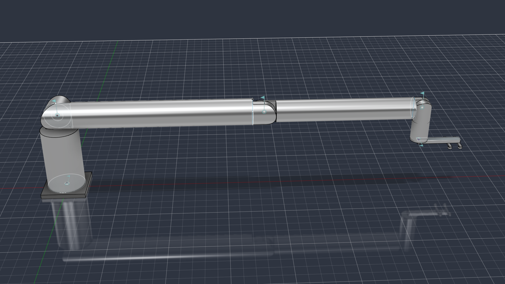

# band_gruppebot i ROS 2 og Gazebo (krav 5)



ELE208 gruppe 4, design challenge 5: robotarm som plukker fra samlebånd i bevegelse.

Robotarmen er modellert i Fusion360, og ble eksport som urdf direkte ved hjelp av fusion2urdf plugin. 
Verden er blitt satt sammen av oss med hjelp fra Claude.
Skriptet som spawner boksene og ordner kameraet er blitt produsert av Claude

Pakken simulerer hele cellen i Gazebo: roboten fra Fusion, et samlebånd som går med 0,3 m/s, esker som kommer med ulik rotasjon og sideposisjon, kamera over båndet, vakuumgriper og et bord for avlevering. Roboten plukker eskene mens båndet går og stabler dem på bordet.

| Krav | Hvor |
|---|---|
| 5.i Robotsystemet i URDF, vist i Gazebo | `urdf/` (robot, griper med TCP, kamera, `ros2_control`) |
| 5.ii Omgivelsene | `worlds/samleband.sdf` (bånd, bord, kamerastativ, lager) og `models/eske.sdf.xacro` |
| 5.iii Styring fra MATLAB over ROS | `matlab/gazebo_styring.m` |

## 1. Installer

```bash
sudo apt install ros-jazzy-ros-gz ros-jazzy-gz-ros2-control ros-jazzy-ros2-control \
                 ros-jazzy-ros2-controllers ros-jazzy-xacro \
                 ros-jazzy-joint-state-publisher-gui python3-numpy
```

## 2. Bygg

```bash
cp -r band_gruppebot ~/ros2_ws/src/
cd ~/ros2_ws
colcon build --symlink-install --packages-select band_gruppebot
source install/setup.bash
```

## 3. Kjør

### Simuleringen i Gazebo

```bash
ros2 launch band_gruppebot gazebo.launch.py
```

Dette skjer:
1. Gazebo starter med cellen, og roboten settes inn i ventestillingen.
2. `joint_state_broadcaster` og `arm_controller` starter. Fra nå holder motorene armen oppe.
3. Seks esker settes inn på lageret (pallen bak båndet). Båndet starter.
4. Hvert 9. sekund mates en eske inn på båndet med tilfeldig rotasjon og sideposisjon. Den første er framme ved roboten etter ca. 11 s.
5. Roboten står i ventestillingen til MATLAB sender en bane (punkt 4).

`celle.py` skriver ut plukkfeilen når vakuumet griper en eske.

| Argument | Standard | Betydning |
|---|---|---|
| `rviz:=true` | `false` | Start RViz2 i tillegg. |
| `kamera:=true` | `false` | La Gazebo lage kamerabilde på `/kamera/image`. |
| `gui:=false` | `true` | Kjør uten Gazebo-vindu. |

**Kjør bare én launch om gangen.** Står en gammel simulering igjen i bakgrunnen, får roboten kommandoer fra to steder og oppfører seg rart. Sjekk med `pgrep -af "gz sim"`, og rydd opp med `pkill -f "gz sim server"`.


## 4. Styr fra MATLAB (krav 5.iii)

```bash
ros2 launch band_gruppebot gazebo.launch.py
```

Kjør så `matlab/gazebo_styring.m`. Skriptet:

## 5. Emner (topics)

| Emne | Type | Retning | Innhold |
|---|---|---|---|
| `/arm_controller/joint_trajectory` | `trajectory_msgs/JointTrajectory` | inn | Leddbane til roboten |
| `/joint_states` | `sensor_msgs/JointState` | ut | Leddvinkler, fart og moment (100 Hz) |
| `/arm_controller/controller_state` | `control_msgs/JointTrajectoryControllerState` | ut | Bestilt og målt, følgefeil |
| `/kamera/deteksjoner` | `geometry_msgs/PoseArray` | ut | Eskene i synsfeltet, i `kamera_optisk`, ±5 mm målefeil (30 Hz) |
| `/vakuum` | `std_msgs/Bool` | inn | Vakuum på/av |
| `/vakuum/status` | `std_msgs/String` | ut | Navnet på eska som holdes, ellers tom |
| `/samleband/fart` | `std_msgs/Float64` | inn | Båndfart i m/s |
| `/model/eskeN/pose` | `geometry_msgs/PoseStamped` | ut | Fasit fra Gazebo (brukes bare av `celle.py`) |


## 6. Slik virker det

**`scripts/celle.py`** er utstyret rundt roboten:
- **Bånd:** holder båndfarten og mater inn esker fra lageret. Esker roboten ikke rekker, faller av enden og sendes rundt på nytt. Blir en eske liggende stille på båndet (Gazebo mister av og til taket), settes den ned på nytt.
- **Kamera:** leser eskenes posisjon i Gazebo, regner om til kameraramma og legger på ±5 mm støy (kravet til sensoren). Synsfeltet er 2,1 × 1,2 m på båndet.
- **Vakuum:** TCP-posisjonen leses fra TF (`world` til `tcp_link`). Når vakuumet er på og sugekoppene står på en eske, lager Gazebo et fast ledd mellom griper og eske (`DetachableJoint`). Roboten kjenner da vekten av eska. Plukkfeilen skrives ut.

**Regulering.** `arm_controller` er en `joint_trajectory_controller` som sender fart til leddene:

```
fart = q_ref_derivert + Kp·(q_ref − q),   Kp = 25 1/s
```

## 7. Filer

| Fil | Innhold |
|---|---|
| `urdf/band_gruppebot.urdf.xacro` | Hele robotsystemet: arm, feste til verden, {0}, TCP, kamera, Gazebo-plugins |
| `urdf/assemblies/band_gruppebot.urdf.xacro` | Armen fra Fusion (lenker, ledd, masser, mesh) |
| `urdf/band_gruppebot.ros2_control.xacro` | `ros2_control`: fart inn, posisjon/fart/moment ut |
| `urdf/band_gruppebot.urdf` | Flat URDF (for `check_urdf`) |
| `config/ros2_controllers.yaml` | `joint_state_broadcaster` og `arm_controller` |
| `config/bro.yaml` | Bro mellom Gazebo og ROS 2 |
| `worlds/samleband.sdf` | Cellen |
| `models/eske.sdf.xacro` | Esken |
| `launch/gazebo.launch.py` | Hele simuleringen |
| `launch/display.launch.py` | RViz med glidebrytere |
| `scripts/celle.py` | Bånd, kamera og vakuum |
| `matlab/kobling_final.m` | Styring fra MATLAB (krav 5.iii) |
| `robot_data.yaml` | Data fra Fusion-eksporten |

## 8. Robotdata (fra Fusion-eksporten)

| Lenke | Masse (kg) | Materiale |
|---|---|---|
| `base_link` | 6,268 | Stål |
| `shoulder_link` | 3,345 | Aluminium |
| `link1` | 3,873 | Aluminium |
| `link2` | 2,256 | Aluminium |
| `link3` | 0,819 | Aluminium |
| `gripper` | 0,091 | Aluminium |

| Ledd | Type | Fra → til | Tilsvarer i DH |
|---|---|---|---|
| `Revolute_1` | continuous | `base_link` → `shoulder_link` | q1 |
| `Revolute_2` | continuous | `shoulder_link` → `link1` | −q2 |
| `Revolute_3` | continuous | `link1` → `link2` | −q3 |
| `Revolute_4` | continuous | `link2` → `link3` | −q4 |
| `Revolute_5` | continuous | `link3` → `gripper` | q5 |

---
*Armen er eksportert med Fusion URDF/XACRO Exporter v3.1.1.*
